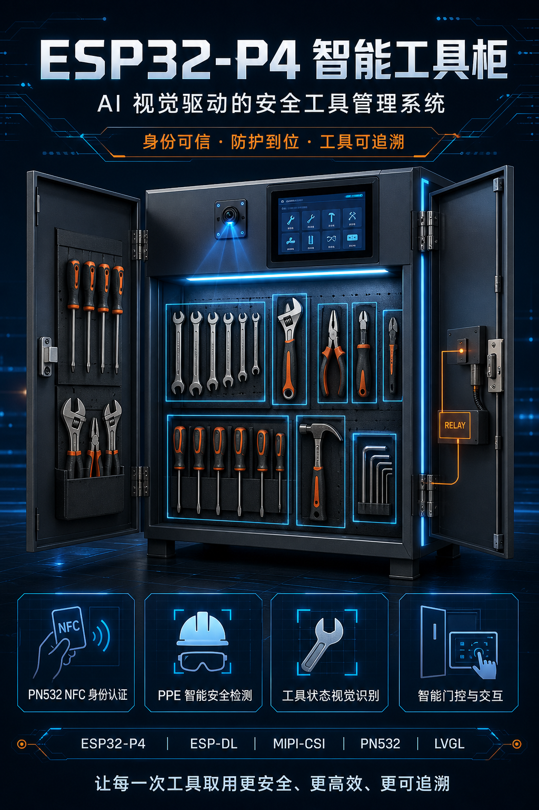

# 2026年嵌赛乐鑫赛道国家一等奖

**ESP32-P4 FOD 智能工具柜 · NFC / 人脸认证 · PPE 检测 · 工具视觉盘点**

本项目面向工具领用、归还与 FOD（Foreign Object Debris，外来物）管理场景，使用 ESP32-P4 在设备端完成身份认证、防护装备检测、柜门控制和 9 件工具的视觉盘点，并保存借还记录、对接外部云端服务。

技术基础：**ESP32-P4 · ESP-IDF 5.5.x · LVGL · ESP-DL 3.3.7 · Apache-2.0**

[项目概览](#项目概览) · [快速开始](#快速开始) · [使用示例](#使用示例) · [源码导览](#源码导览) · [当前限制](#当前限制) · [问题与贡献](#问题与贡献) · [开发手册](docs/DEVELOPMENT.md)

<p align="center">
  
  <br>
  <sub>项目概念渲染图，用于展示应用场景；硬件连接与功能以源码和开发手册为准。</sub>
</p>

## 项目概览

主工程位于 [`examples/esp_brookesia_phone`](examples/esp_brookesia_phone)。目录名沿用 ESP-Brookesia Phone 示例，实际应用已改为智能工具柜。LVGL v8 / v9 示例独立保留，便于参考显示与触摸适配。

| 功能 | 设备端实现 |
| --- | --- |
| 用户注册与管理 | 工号、姓名、中文输入，人脸录入和 NFC 卡绑定，管理员查看与删除用户 |
| 身份认证 | 用户选择 NFC 或人脸认证，通过其中一种后进入 PPE 检测 |
| PPE 检测 | MIPI 摄像头采集画面，本地运行头盔与护目镜模型，提供预览和重试 |
| 柜门控制 | GPIO 限时脉冲控制门锁，UART IMU 检测箱盖打开及稳定状态 |
| 工具视觉盘点 | USB 摄像头预览与拍照，按 8 个类别统计 9 件工具，其中两把螺丝刀共享一个类别 |
| 借还记录 | 对比操作前后库存，展示借出、归还及异常；本地保存最多 100 条记录 |
| 网络与云端 | Wi-Fi 配置、待机重连、SNTP 校时，以及图片、事件和库存快照上传 |

仓库包含设备端固件、推理模型、依赖补丁和展示资料。云端后台、Web 前端、训练代码及训练数据集需要另行准备。当前护目镜阈值为 `0`，电子钳固定判为在位，使用前请阅读[当前限制](#当前限制)。

## 快速开始

### 准备硬件与环境

- **开发板与显示：** ESP32-P4 Function EV Board，匹配当前配置的 Flash / PSRAM，以及 1024 × 600 MIPI-DSI 触摸屏。
- **摄像头与存储：** SC2336 MIPI-CSI 摄像头、支持 MJPEG 的 USB UVC 摄像头和 SD 卡。
- **身份与门控：** PN532 UART 模块、兼容源码协议的 UART IMU、门锁驱动电路。
- **开发环境：** Git、Python 3.10+、ESP-IDF 5.5.x。最低要求为 **5.5.3**，当前依赖锁文件记录 **5.5.4**，复现时优先使用 5.5.4。

完整接线、串口参数、IMU 协议和板卡配置见[硬件要求与接线](docs/DEVELOPMENT.md#硬件要求与接线)。ESP32-P4 的 Wi-Fi 依赖板载无线协处理器及匹配的 ESP-Hosted 固件。

### 获取、配置与烧录

在已加载 ESP-IDF 环境的终端中执行。Windows 可使用 ESP-IDF 安装器提供的终端，Linux/macOS 先加载对应版本的 `export.sh`。

```sh
git clone https://github.com/liuchang925/2026-Espressif-Embedded-Contest-National-First-Prize.git
cd 2026-Espressif-Embedded-Contest-National-First-Prize/examples/esp_brookesia_phone

idf.py --version
idf.py set-target esp32p4
idf.py reconfigure

python tools/apply_esp_dl_patch.py --check
python tools/apply_esp_dl_patch.py
idf.py reconfigure

idf.py menuconfig
idf.py build
idf.py -p PORT flash monitor
```

将 `PORT` 替换为实际串口，例如 `COM5` 或 `/dev/ttyUSB0`。首次配置需要联网下载依赖；构建入口在主工程目录，须保留相邻的 `common_components`。

配置时注意：

- 核对芯片版本、Flash / PSRAM、摄像头、屏幕和 SD 卡配置；当前默认面向旧版本 ESP32-P4 芯片。
- 保留补丁步骤。补丁修复删除用户后的人脸 ID 映射问题，生成本地 esp-dl 覆盖副本，不修改下载的依赖原件。详见[补丁说明](examples/esp_brookesia_phone/patches/README.md)。
- `Cloud Uploader` 中的后端地址与密钥默认为空，本地运行可保持为空；需要上传时再填写设备编号和服务配置。
- 注册与管理员演示 PIN 均为 **`000000`**，实际使用前应修改源码中的对应值。生成的 `sdkconfig` 已被 Git 忽略。

详细步骤见[环境与快速开始](docs/DEVELOPMENT.md#环境与快速开始)。开源整理时未执行固件编译、烧录或上板测试，需要按实际硬件验证。

## 使用示例

### 完成一次领用或归还

1. **注册用户：** 进入注册页，输入注册 PIN，填写工号、姓名，再绑定 NFC 或人脸；人脸录入采集 3 个特征样本。
2. **验证身份：** 在待机页选择 NFC 或人脸认证。普通认证等待窗口为 60 秒，通过后进入 PPE 页面。
3. **检查装备：** 面向 MIPI 摄像头，在预览页点击检测；通过后启动开门流程，失败可调整后重试。
4. **打开箱盖：** 程序启动 IMU 检测并输出最长 5 秒开锁脉冲。IMU 以本轮首个有效 X 轴角度为基准，正向变化至少 45°、在 2° 范围内稳定约 1.5 秒后，判定为打开。
5. **取放工具：** USB 摄像头显示预览，保留 15 秒取放时间；随后拍照、运行模型并更新盘点结果。
6. **确认关门：** 关闭箱盖，在 15 秒确认窗口内点击“确认关门”；程序输出 2 秒关门控制脉冲，显示借还结果并尝试上传。

初次使用以全部工具在位为库存基线，之后加载持久化状态。开始操作时保持箱盖关闭，打开后让工具完整进入摄像头视野，并在盘点结束后确认关门。未及时确认会产生 `door_unconfirmed` 事件，稍后确认可发送关联的 `door_closed` 事件。

### 从哪里查看结果

| 场景 | 查看位置与结果 |
| --- | --- |
| 查看本次领用、归还 | 结果页中的借出、归还、异常和云端同步状态 |
| 查看历史操作 | 工具记录页；本地记录位于 SPIFFS |
| 查看库存 | 待机页的工具数量、盘点页的 9 个工具状态 |
| 调整网络或用户 | 待机页的 Wi-Fi 设置、注册页及管理员页 |
| 对接自己的后端 | [云端接口与配置](docs/DEVELOPMENT.md#云端接口与配置)，包含 4 个接口、配置示例及图片上传响应格式 |

工具清单、模型文件、数据存储路径和盘点规则见[开发与部署手册](docs/DEVELOPMENT.md)。

## 源码导览

```text
.
├── README.md                         # 项目入口与快速使用
├── CONTRIBUTING.md                   # 问题反馈和贡献流程
├── LICENSE                           # Apache-2.0
├── THIRD_PARTY_NOTICES.md             # 第三方许可及资料说明
├── docs/
│   ├── DEVELOPMENT.md                # 完整硬件、部署、接口和校验手册
│   └── upstream/                    # 原始开发板说明
└── examples/
    ├── common_components/bsp_extra/  # 主工程所需板级扩展
    ├── esp_brookesia_phone/          # 智能工具柜主工程
    │   ├── main/                    # 初始化、业务和硬件服务
    │   │   ├── screens/             # 认证、注册、盘点、管理员和记录页面
    │   │   ├── ui/                  # 页面管理、样式及触摸布局
    │   │   └── fonts/               # 中文字体与覆盖检查
    │   ├── components/              # 摄像头、人脸、PPE 和工具模型封装
    │   ├── patches/                 # esp-dl 补丁、版本与文件摘要
    │   ├── tools/                   # 补丁工具、资源校验和规则测试
    │   └── docs/                    # 海报和演示资料
    ├── lvgl_demo_v8/                # 独立 LVGL v8 示例
    └── lvgl_demo_v9/                # 独立 LVGL v9 示例
```

阅读代码可从 [main.cpp](examples/esp_brookesia_phone/main/main.cpp) 的初始化开始，再查看 [screen_auth.c](examples/esp_brookesia_phone/main/screens/screen_auth.c) 的认证流程、[screen_usb_preview.c](examples/esp_brookesia_phone/main/screens/screen_usb_preview.c) 的开门与盘点流程，以及 [cabinet_core.c](examples/esp_brookesia_phone/main/cabinet_core.c) 的库存、关门和记录处理。

## 当前限制

| 项目 | 当前行为与使用边界 |
| --- | --- |
| PPE 参数 | 头盔存在阈值为 `0.1`，护目镜为 `0`；采用 `score >= threshold`，正常非负护目镜分数即通过，不能据此确认实际佩戴 |
| 电子钳盘点 | class 4 固定判为在位，不能反映电子钳真实缺失状态 |
| 摆放位置 | 按类别和数量分配到柜位，不严格验证摆放位置，也不能可靠区分同类实物身份 |
| 关门状态 | `door_confirmed` 来自用户按钮确认，IMU 用于开盖判定，没有独立门磁证明已经闭锁 |
| 管理员入口 | 管理员 PIN 验证后可直接开门，绕过普通用户认证与 PPE 检测 |
| 云端与断网 | 后台需要另行实现；本地保存同步状态，但未提供完整的持久化失败队列与恢复联网后自动补传 |
| 认证与性能 | 静态 PIN、NFC UID 匹配和人脸识别仍需按用途完善；没有人脸活体检测，本次未复测准确率、延迟及长期稳定性 |

当前阈值和模型行为保持原样。完整参数、文件位置和解释见[手册中的当前限制](docs/DEVELOPMENT.md#当前限制)。

## 检查与常见问题

在主工程目录运行以下不依赖开发板的检查：

```sh
python tools/verify_tool_inventory_assets.py .
python tools/test_tool_inventory_policy.py .
python main/fonts/check_font_coverage.py --project-root .
```

开源整理时已通过工具模型 SHA-256 与槽位检查、13 项规则测试、6769 个内置字形的 UI 覆盖检查，以及补丁工具和密钥扫描。上述检查不替代固件编译和上板验证。

| 遇到的问题 | 建议先检查 |
| --- | --- |
| 人脸模型不可用、无法注册人脸 | SD 卡挂载日志、模型准备结果及 `/sdcard` 存储状态 |
| 无法进入 USB 预览或盘点 | IMU 协议、安装方向、X 轴开盖变化及稳定条件；随后检查 UVC 摄像头连接与 MJPEG 模式 |
| 云端同步失败 | 后端地址、Wi-Fi、设备密钥、服务端接口和返回状态；地址为空时会跳过请求 |
| 删除用户后识别信息错位 | esp-dl 3.3.7 的 ID 补丁是否已应用、构建是否采用本地覆盖组件 |
| 只复制主工程后构建缺少组件 | 恢复相邻 `common_components`，按完整仓库布局配置 |

更详细的检查方法和数据位置见[开发与部署手册](docs/DEVELOPMENT.md)。

## 问题与贡献

通过 [GitHub Issues](https://github.com/liuchang925/2026-Espressif-Embedded-Contest-National-First-Prize/issues) 反馈问题或提出建议。请附板卡型号、ESP-IDF 版本、复现步骤及相关日志，提交前移除密码、设备密钥和人员数据。

文档修正、问题复现、硬件适配、模型与盘点规则改进都可以通过 Pull Request 提交。Fork、分支、检查和提交说明见 [CONTRIBUTING.md](CONTRIBUTING.md)。

## 资料、致谢与许可证

- [开发与部署手册](docs/DEVELOPMENT.md)：详细接线、操作、存储、工具模型和云端接口。
- [开发板原始说明](docs/upstream/README.md)、[LVGL v8 中文说明](examples/lvgl_demo_v8/README_CN.md)、[LVGL v9 中文说明](examples/lvgl_demo_v9/README_CN.md)。
- [历史研究展示海报](examples/esp_brookesia_phone/docs/esp32-p4-smart-tool-case-academic-poster.png)、[软件设计演示文稿](examples/esp_brookesia_phone/docs/ppt/software-design-editable-v2.pptx)。

感谢 Espressif 的开发板示例、ESP-IDF、ESP-Brookesia、ESP-DL 及 LVGL 等项目。README 的组织参考了泡沫o0的[《如何编写 README.md：打造出色的开源项目文档》](https://zhuanlan.zhihu.com/p/679934993)，结合本工程补充了安装使用、源码导览、问题反馈与贡献入口。

海报和演示资料包含历史设计、概念渲染和阶段性实验描述，其中的云端平台与性能数字不代表当前仓库已提供或本次已复现。当前实现以源码和开发手册为准。

项目自有贡献采用 [Apache License 2.0](LICENSE)。第三方组件保留各自的 MIT、CC0-1.0、Apache-2.0、SIL OFL 等许可，详见 [THIRD_PARTY_NOTICES.md](THIRD_PARTY_NOTICES.md)。
